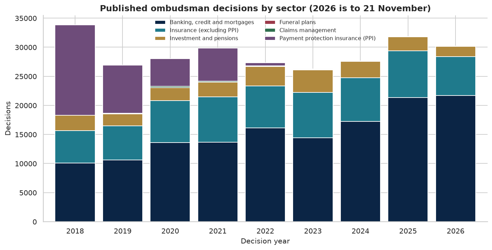
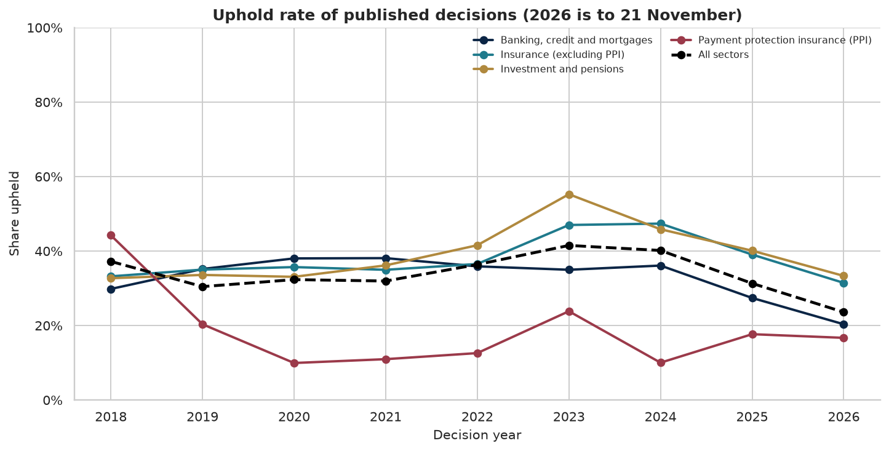
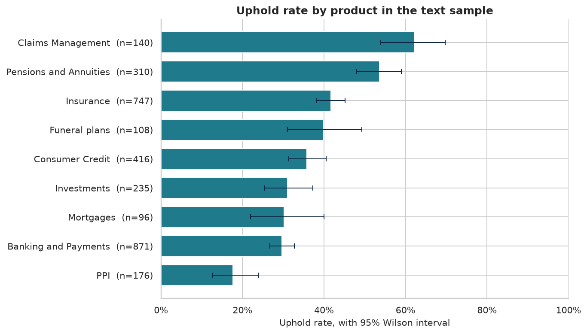
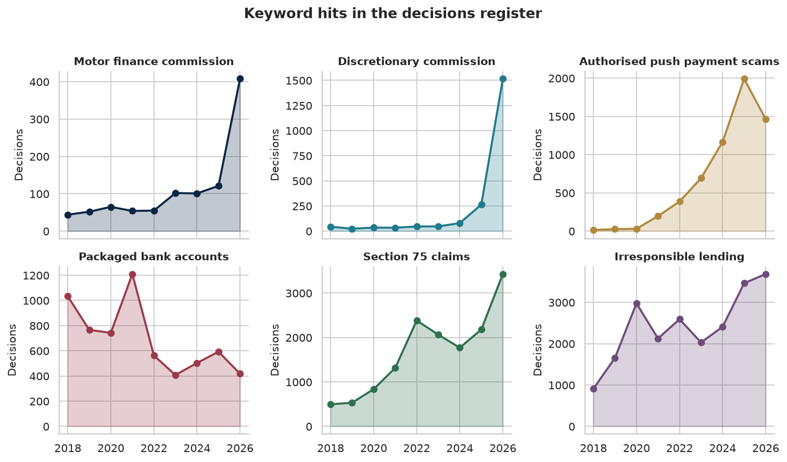
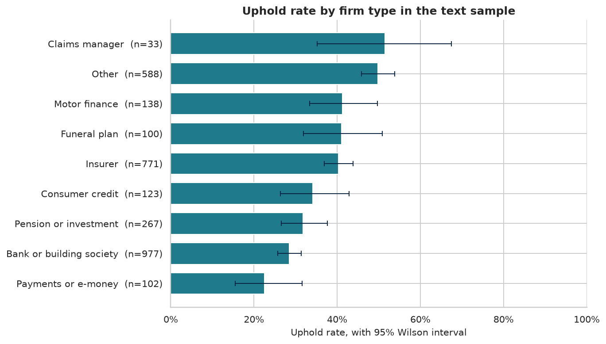
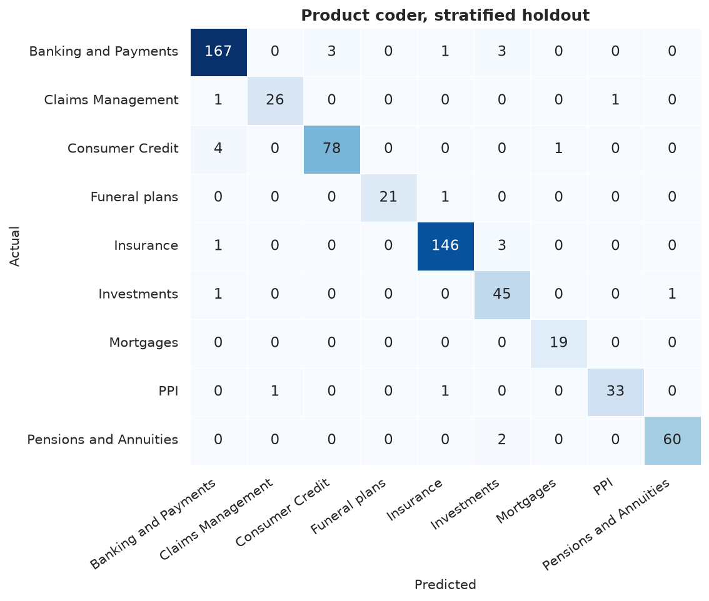
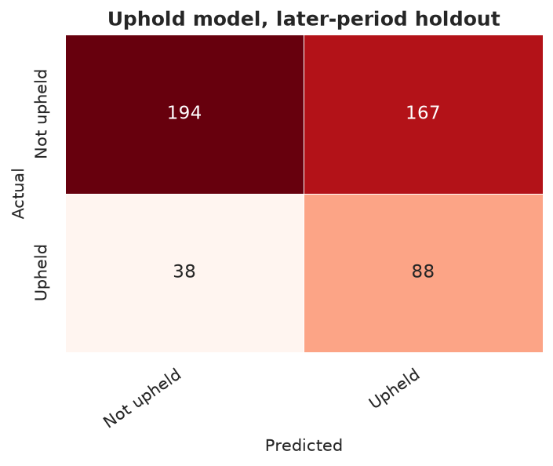

# Complaint triage for UK financial firms

A complaints team at a bank, insurer or lender has to code the product, see what the customer says went wrong, and decide how quickly the case needs a specialist. This project does those three things from the complaint narrative: a product code, a probability that an ombudsman would uphold the case, and a two-sentence case note.

It is trained on final decisions published by the Financial Ombudsman Service (FOS). The label for the second model is the published outcome. That is a harder and more useful question than sentiment. It is also a different population from the complaints a firm closes itself: only unresolved cases reach an ombudsman.

The served model is a TF-IDF logistic regression. On a later-period holdout it ranks upheld cases with **ROC-AUC 0.682**. Product coding on a stratified holdout has **macro F1 0.957**, against 0.049 for always guessing the most common product. Those numbers are from the run in this repository. The notebooks recompute them.

## What the model is allowed to read

A published decision is written after the outcome is known. A typical decision has a complaint, a background ("what happened"), and then the ombudsman's reasoning ("what I've decided", "my final decision", "putting things right"). Training on the whole document would leak the label.

The pipeline keeps the complaint and the factual background. It stops a section at the first sentence that states a view on the merits: *upheld*, *uphold*, an investigator or adjudicator, a provisional decision, "put things right", or "fair and reasonable". After that cut, none of the 3,099 training narratives contains those tokens.

What remains is still the ombudsman's paraphrase, not the customer's email and not the firm's case file. Several holdout misses are decisions that say the facts are "well known to both parties" and then put the substance in the reasoning section, which has been removed. A firm at intake has the customer's own words. This corpus is a proxy.

The product code is the register's product chip. On PPI-sector results that chip often still says "Insurance", while the complaint is about payment protection insurance. Those rows are labelled PPI. The sector filter is the register's own PPI flag.

Firm name is not a model feature. A handler already knows their own firm. Names do still appear inside the narrative, and the linear model puts weight on tokens such as "Halifax" and "Lloyds". Part of the score can be "this firm is upheld more often", which would not exist inside a single firm. That is a reason to retrain on the firm's own book before using the score operationally.

## Data

Source: the [FOS ombudsman decisions search](https://www.financial-ombudsman.org.uk/businesses/resolving-complaint/ombudsman-decisions). The register holds final decisions published since 1 April 2013 under the Financial Services and Markets Act 2000. Complainants are anonymised. Firms are named.

`robots.txt` allows the decisions search and the decision PDFs. It disallows four complaint-form PDFs, and the collector refuses those URLs. Requests are one at a time, 0.75 seconds apart, with a disk cache. Collected on 22 November 2026.

Two different extracts are used, and they answer different questions.

| Extract | What it is | What it is for |
| --- | --- | --- |
| Search hit counts, 2018–2026 | Every published decision in the window. 2026 runs to 21 November. | Volumes, uphold rates, topical keywords |
| Text sample, 3,099 decisions | Newest decisions in each year × sector cell from 2022, capped (banking 280 a year, fewer in smaller sectors). 3,131 PDFs downloaded, 32 dropped as too short after the leakage cut. All text is from the PDF, not the search snippet. | The models |

The text sample is not a census. Within each year it is the late decisions, so dates cluster: the latest 15% of the sample is the publication week **30 September to 6 October 2026**. Decision dates in the sample run from 17 May 2022 to 6 October 2026. Median intake length is 1,242 characters. The sample uphold rate is 37.0%.

The FOS website terms say the Service owns copyright in site material and that storing it in another retrieval system needs permission. This repository does not republish the decisions database. It commits:

- the hit counts (`data/aggregates/population_counts.json`)
- a case index with no complaint prose (`data/aggregates/case_index.csv`)
- 36 short quotations of the complaint section only (`data/sample/decisions.jsonl`), each with a link to the decision PDF

Raw HTML, PDFs and the full intake table stay in gitignored caches. `python -m fos_triage.collect` rebuilds them.

## What the register shows

From 2018 through 21 November 2026 the search reports **261,910** published decisions, of which **88,350** (33.7%) were upheld. Uphold and not-upheld counts add up to the reported total in every year.

PPI is the early book and then it disappears. Banking, credit and mortgages becomes the book that grows.



| Year | PPI decisions | PPI uphold rate | Banking, credit and mortgages | Banking uphold rate | All sectors uphold rate |
| --- | ---: | ---: | ---: | ---: | ---: |
| 2018 | 15,511 | 44.2% | 10,098 | 29.8% | 37.2% |
| 2021 | 5,647 | 10.9% | 13,667 | 38.1% | 31.9% |
| 2023 | 126 | 23.8% | 14,446 | 34.9% | 41.5% |
| 2024 | 20 | 10.0% | 17,251 | 36.1% | 40.1% |
| 2026 to 21 Nov | 6 | 16.7% | 21,686 | 20.3% | 23.6% |

The overall uphold rate was 41.5% in 2023 and 23.6% in 2026. Banking moved from 36.1% in 2024 to 20.3% in 2026. A model fit on 2022–2024 and scored on 2026 is the honest test, which is why the uphold split is by decision date.



Claims management and funeral plans are left off that chart. Their annual totals are in the tens, and a rate on 30 decisions swings too much to sit on the same axis. In the text sample, claims-management decisions are upheld more often than PPI decisions, with a wide interval.



Keyword hit counts are a watchlist, not a partition. A decision can match more than one phrase.



| Phrase | 2018 | 2021 | 2024 | 2025 | 2026 to 21 Nov |
| --- | ---: | ---: | ---: | ---: | ---: |
| Authorised push payment | 15 | 196 | 1,166 | 1,992 | 1,465 |
| Discretionary commission | 44 | 34 | 80 | 264 | 1,516 |
| Motor finance commission | 44 | 54 | 101 | 121 | 408 |
| Packaged bank account | 1,033 | 1,210 | 503 | 593 | 418 |
| Irresponsible lending | 910 | 2,127 | 2,409 | 3,462 | 3,686 |
| Section 75 | 496 | 1,315 | 1,770 | 2,179 | 3,429 |

Authorised push payment decisions rise from 15 in 2018 to 1,992 in 2025. "Discretionary commission" is almost flat until 2025 and then jumps to 1,516 in 2026. The narrower phrase "motor finance commission" rises too, to 408, and the two phrases overlap. Packaged-account decisions are lower than they were in 2021. Irresponsible lending and section 75 stay large. These are the books a UK complaints-operations team is staffed around. The 2026 banking uphold-rate drop sits in the same year as the commission-case jump. The counts do not, by themselves, say that commission cases caused the drop.

Firm type in the sample is a name gazetteer, not a regulatory category. 588 of 3,099 names fall through to "other".



## Models

Both models are word and bigram TF-IDF (20,000 features, sublinear tf, English stop words) and class-balanced logistic regression. The vectoriser is fit on the training rows only.

**Product.** Stratified 80/20. The category list is stable, so a random split asks whether the narrative identifies the product. Macro F1 is **0.957** (accuracy 0.960) against a majority-class macro F1 of **0.049**. The same coder, fit only on earlier decisions and scored on the last publication week, has macro F1 **0.943**. The lowest class is investments at 0.900. The confusions that remain are the ones a coder would argue about: banking and payments versus consumer credit, and pensions versus investments.



The linear weights are the product words a handler would use: *ppi*, *pension*, *sipp*, *mortgage*, *funeral plan*, *insurance policy*, *loan*. Product coding on this corpus is largely lexical. The operational value is consistent MI coding at intake, not a hidden pattern. That is still worth automating, and it is why the uphold model is the one that has to earn its place.

**Uphold.** Split by decision date. No date is in more than one of train, validation and test.

| Slice | Decisions | Dates | Uphold rate |
| --- | ---: | --- | ---: |
| Train | 2,069 | 17 May 2022 – 21 Dec 2025 | 41.5% |
| Validation | 543 | 22 Dec 2025 – 29 Sep 2026 | 29.8% |
| Test | 487 | 30 Sep 2026 – 6 Oct 2026 | 25.9% |

Probabilities are Platt-scaled on the validation slice. The threshold (0.275) maximises validation F1. On the test week:

| | ROC-AUC | Average precision | F1 | Precision | Recall | Brier |
| --- | ---: | ---: | ---: | ---: | ---: | ---: |
| Model | 0.682 | 0.471 | 0.462 | 0.345 | 0.698 | 0.176 |
| Baseline | 0.500 | 0.259 (the test rate) | 0.000 | | | 0.216 |

The baseline predicts the training majority class, which on this week is "not upheld" and is right 74.1% of the time, with F1 of zero because it never calls an uphold. Accuracy is the wrong headline. The model finds 88 of 126 upheld cases (recall 69.8%) and is wrong on 167 not-upheld cases. Average precision 0.471 against a 25.9% base rate, and a Brier score better than always predicting the training rate (0.176 against 0.216), are the results to keep.



A stricter cut changes the queue. On the same test week, score at least 0.40 marks **13.3%** of cases, with precision **55.4%** and recall **28.6%**. The demo calls that band high priority. The validation threshold calls 52.4% of the week high enough to review and is a recall-oriented setting. Neither cut is a property of the ombudsman. A firm would set them from the cost of a missed upheld case against the cost of a specialist reading a case that will not be upheld.

Tokens that push the linear score up are about the dispute (*delays*, *transfer*, *claim*, *advice*, *dealership*), not about the outcome. Tokens that push it down include firm names. See the caveat above.

A one-epoch fine-tune of `distilbert-base-uncased` on the same date split (max length 128, class-weighted loss, CPU) does not beat the linear model. On the same test week its ROC-AUC is **0.579**, average precision **0.366**, F1 **0.408**, and Brier score **0.225**, which is worse than predicting the training uphold rate. Truncating a 1,242-character intake to 128 tokens throws away most of the background, and one epoch is not a full fine-tune. The API therefore serves the TF-IDF model, which is also the model stored in the repository. Re-run with `python -m fos_triage.transformer` if you want to spend more epochs.

### Where it is wrong

High-scoring cases the ombudsman did not uphold, from the test week, are ordinary hard disputes: a mishandled motor claim, a defined-benefit transfer recommendation, a declined accidental-damage claim, an escape-of-water claim. The narrative looks like other cases that are upheld. The model has no surveyor report and no policy wording.

Low-scoring cases that were upheld are often thin for a different reason. The decision says the facts are "well known to both parties, so I won't repeat them", and the substance then sits in the reasoning section, which is excluded. The model is scored on a paragraph that refuses to state the facts. That will not happen in the same way on a firm's own case file, and it puts a ceiling on how good a model of *published decisions* can be.

## How a complaints team would use it

Under **DISP 1.6** a firm sends a final response within eight weeks, or a written explanation of why it cannot and a referral to FOS. Payment-service and e-money complaints are shorter: 15 business days, or 35 in exceptional circumstances (**DISP 1.6.2AR**). **DISP 1.3.3R** requires the firm to identify and remedy recurring or systemic problems, including by analysing the causes of complaints. The Consumer Duty (Principle 12 and PRIN 2A) requires the firm to act to deliver good outcomes for retail customers and to monitor where those outcomes fail. Complaints are one of the feeds for that monitoring.

The endpoint is a triage aid at the point the complaint is read:

1. Suggest the product code that goes into complaints MI and, later, the firm's complaints return.
2. Put a higher score on a specialist queue (APP reimbursement, motor-finance commission, funeral plans, claims-management fees) so the eight-week clock is not spent on the wrong desk.
3. Attach a two-sentence extractive note and a few key phrases, so the handler does not start from a blank screen.

It does not accept, reject, or redress a complaint. It is not a final response, and it is not a fair-and-reasonable determination. A person reads the case.

**Time estimate, assumptions labelled as such.** These are not a time study and not a forecast.

- Assume a handler spends 8 minutes coding a new complaint and writing the first case note.
- Assume a suggested product code and a two-sentence note save 3 of those minutes, and the handler still reads the complaint.
- On an illustrative book of 10,000 complaints a year, that is 30,000 minutes, **500 hours**. It says nothing about a named firm.

The queue effect is separate and was measured. On the last publication week, reviewing the 13.3% of cases scored at least 0.40 would have covered 28.6% of the cases the ombudsman later upheld, at 55% precision against a 26% base rate. Whether that trade is worth a specialist's time is a resourcing decision.

## API and demo

The API loads the committed TF-IDF models. No key is required.

```bash
pip install -r requirements.txt
uvicorn fos_triage.api:app --app-dir src
```

```bash
curl -s localhost:8000/triage \
  -H 'content-type: application/json' \
  -d '{"text":"The customer complains the insurer declined a home claim after a pipe leaked and ruined the kitchen units.","business_name":"Example Insurance Ltd"}'
```

The response has a product with the top three codes, an uphold probability and a priority band, an extractive summary, key phrases, and a disclaimer. If the paste contains "what I've decided" or "my final decision", the service scores the complaint and background only.

```bash
streamlit run src/fos_triage/streamlit_app.py
```

```bash
docker build -t complaint-triage .
docker run -p 8000:8000 complaint-triage
```

An optional DistilBERT fine-tune of the uphold task is `python -m fos_triage.transformer` after `pip install -r requirements-transformer.txt`. It is not required for the API. Weights are gitignored.

## Limitations and ethics

- The population is final ombudsman decisions, not complaints a firm receives. Most complaints never get there. An uphold rate on this register is not the firm's uphold rate, and it is not a forecast of the next complaint.
- The text is written after the event, by the decision-maker, in the decision-maker's voice. The leakage cut removes outcome sentences. It cannot turn the prose into the customer's original account.
- The test period is one publication week, because the sample takes the newest decisions in each year and dates pile up. It is a real forward split. It is not a year of drift.
- Product coding looks strong because customers name the product. That will not transfer to a messy free-text inbox without checking.
- Firm names inside the narrative can stand in for firm base rates.
- Keyword charts overlap and follow the search engine's matching. They are not a coded root-cause taxonomy.
- Firm type is a gazetteer. "Other" is still 588 cases.
- Complainants in the source are anonymised. Firms are not. This repo does not add complainant detail. Do not use the score to identify a customer.
- Do not send a customer a model probability as if it were the firm's decision. DISP requires a reasoned final response from the firm.
- FOS says published decisions are not a definitive statement of the law or of its approach. Each case turns on its facts. The model is a comparison with past published outcomes, not a prediction of what an ombudsman must do.

## Reproduce

```bash
pip install -r requirements.txt
python -m fos_triage.collect counts          # register hit counts, cached
python -m fos_triage.collect corpus          # PDFs and metadata, polite delay
python -m fos_triage.build_dataset           # intake text, leakage cut
python -m fos_triage.train                   # models, metrics, figures
pytest
```

Notebooks:

- `notebooks/01_register_and_sample.ipynb` reads the hit counts and the case index.
- `notebooks/02_product_and_uphold.ipynb` recomputes the holdout metrics from `reports/uphold_holdout.csv`.

Both are stored with their outputs.

Tests cover the leakage cut, the search-page parser, the date split, the summary, and the HTTP schema. GitHub Actions runs them on Python 3.12.

## Attribution and licence

Decision text, dates, outcomes, product chips and firm names are from the Financial Ombudsman Service ombudsman decisions database, [financial-ombudsman.org.uk](https://www.financial-ombudsman.org.uk/businesses/resolving-complaint/ombudsman-decisions). Read a case on the Service's own PDF, linked from the case index and the sample file.

Handbook references are to the FCA Handbook (DISP and PRIN) as published by the Financial Conduct Authority.

The code in this repository is released under the MIT licence. See `LICENSE`. The licence does not apply to FOS material. Short complaint-section quotations are included so the code can be run, with a link back to the decision.
